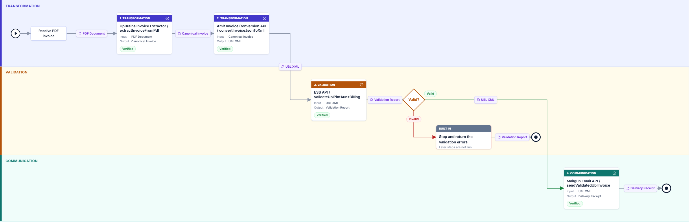
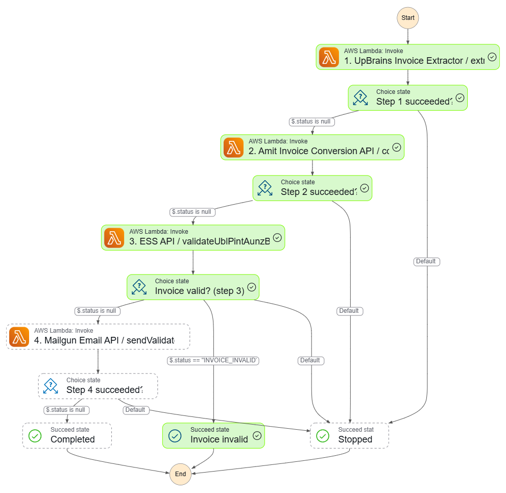

# BP Builder

BP Builder turns a description of an invoice process into a workflow of real
API calls and deploys it to AWS. Describe the process in words, upload a BPMN
diagram or a sketch, or assemble it visually; BP Builder finds the chains of
registered API operations that can carry it out, checks that their data fit
together before anything runs, executes the workflow against the live services
and deploys it as AWS Lambda functions connected by a Step Functions state
machine.



## What BP Builder does, and what it does not

BP Builder is the **composition and deployment layer**. It does **not** provide
or host the external APIs a workflow calls. You bring your own accounts for the
services you want to use and maintain the **operation catalog**: the list of
API operations BP Builder may compose, each described once against a shared
canonical invoice model. From that catalog BP Builder

- reads what you want (from text, a BPMN file, a sketch or the visual editor);
- searches for chains of operations whose documents connect, in the fixed
  order Transformation → Validation → Communication;
- rejects, before any call, chains whose documents, order or required fields
  do not fit, and explains why;
- runs workflows with the real services and records each run;
- deploys a workflow to AWS with one action.

The repository ships an example catalog for electronic invoicing: invoice
extraction from PDF and image files (UpBrains), conversion to UBL XML (a public
converter deployment), validation against EN 16931 and the Australian and New
Zealand Peppol rules (ESS validation API), and delivery by email (Mailgun). Use
it as a starting point; each of these services needs your own account and
credentials, and you can replace or extend them with operations of your own.

## How it works

```text
bp-builder-frontend/ design environment (React, TypeScript, Vite, Tailwind CSS, bpmn-js)
bp-builder-backend/  catalog, planner, completeness checker, test runs, deployment, REST API (Spring Boot)
workflow-runtime/    canonical mapping and the workflow executor (plain Java: no Spring, JPA or AWS)
lambda-runner/       AWS Lambda adapter around workflow-runtime
```

- **Operation contracts.** Every catalog operation states its stage, the
  document it consumes and produces, how its request is built and
  authenticated, how its response is read, and how its fields map to the
  canonical model. Connecting operations therefore needs no adapter per pair.
- **Planning and checking.** The planner searches the catalog by document
  transitions; the checker verifies stage order, document flow and required
  fields. Only chains that pass can be run or deployed.
- **Constrained language model.** Google Gemini only reads the user's intent
  into a fixed schema (input, result, rule set, whether to send); every value
  is validated by the backend, and the model never chooses operations.
- **One runtime, two places.** Test runs execute in the backend; deployed
  workflows run the same executor, one AWS Lambda component per operation,
  connected by a Step Functions state machine. A validation that rejects the
  invoice ends the run before anything is sent.



## Getting started

### Requirements

- Java 17 (Maven is included through `mvnw` / `mvnw.cmd`)
- Node.js 22 and npm
- PostgreSQL
- Accounts for the external services you want to run. Planning and checking
  work without any of them.

### 1. Database

Create an empty PostgreSQL database, run
`bp-builder-backend/src/main/resources/db/schema.sql`, then run the files in
`bp-builder-backend/src/main/resources/db/migrations/` **once each, in numeric
version order** (V2, V3, V4, V6, …, V19), stopping at the first error. Sorting
by file name puts V10 before V2 and produces a wrong catalog.

```bash
psql "$DATABASE_URL" -v ON_ERROR_STOP=1 -f bp-builder-backend/src/main/resources/db/schema.sql
for f in $(ls bp-builder-backend/src/main/resources/db/migrations/V*.sql | sort -V); do
  psql "$DATABASE_URL" -v ON_ERROR_STOP=1 -f "$f" || break
done
```

The migrations create the 39-field canonical invoice model and the example
catalog of six operations. Before running `V10__mailgun_fixed_sender.sql`,
replace `<your-mailgun-domain>` with the domain of your own Mailgun account.

### 2. Configuration

All secrets are read from environment variables; the repository and the
catalog store only variable names.

| Variable | Used for |
| --- | --- |
| `SPRING_DATASOURCE_URL`, `SM_DB_USER`, `SM_DB_PASS` | database connection |
| `GEMINI_API_KEY`, `GEMINI_MODEL` (optional) | reading text requirements and sketches |
| `UPBRAINS_INVOICE_EXTRACT_URL`, `UPBRAINS_IMAGE_EXTRACT_URL` | invoice extraction from PDF and image files (the webhook URL is the credential) |
| `SMARTDOCFLOW_API_KEY` | ESS validation API |
| `MAILGUN_MESSAGES_URL`, `MAILGUN_API_KEY`, `MAILGUN_TO` | sending validated invoices by email |
| `AWS_ACCESS_KEY_ID`, `AWS_SECRET_ACCESS_KEY`, `AWS_REGION`, `LAMBDA_EXECUTION_ROLE_ARN`, `STEP_FUNCTIONS_ROLE_ARN` | deploying workflows to AWS |

Only the services used by your workflows need to be configured. When a
workflow is deployed, each Lambda component receives only the variables its
own operation needs.

### 3. Run

```bash
./mvnw -pl bp-builder-backend -am package -DskipTests
java -jar bp-builder-backend/target/bp-builder-backend-0.0.1-SNAPSHOT.jar   # http://localhost:8081

cd bp-builder-frontend
npm install
npm run dev                                                                # http://localhost:8443
```

Set `VITE_API_BASE_URL` in `bp-builder-frontend/.env.local` if the backend
runs elsewhere.

### 4. Test

```bash
./mvnw test
```

The tests use recorded service responses and an in-memory HTTP transport;
they call no external service, language model or database.

### 5. Deploy workflows to AWS

Build the Lambda packages, then use **Deploy** on a workflow in the interface:

```bash
./mvnw -pl lambda-runner -am package
```

The one-time AWS setup (an execution role for the functions, a role for Step
Functions and a deployment user with scoped permissions) is described in
[`lambda-runner/README.md`](lambda-runner/README.md). Deployed workflows are
reached through Lambda function URLs **without authentication**; add
authentication before exposing them beyond testing.

## Adding your own operations

The catalog lives in the database (`apis`, `api_operations`,
`operation_field_mappings`, `canonical_fields`). To add a service, register its
operation with its stage, input and output document types, endpoint and
authentication (referencing environment variable names), and an outcome rule
for validation or sending; then map its fields to the canonical model and
approve the mappings. The example operations registered in
`V3__observed_transformation_operations.sql`,
`V9__smartdocflow_and_mailgun_operations.sql` and
`V19__upbrains_image_extractor.sql` show the SQL for a complete registration,
and [`bp-builder-backend/README.md`](bp-builder-backend/README.md) describes
the catalog and the REST API.
